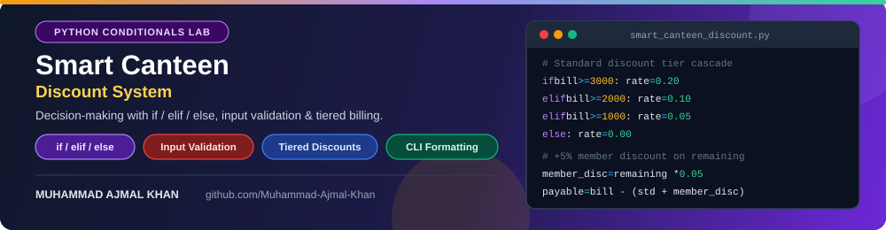
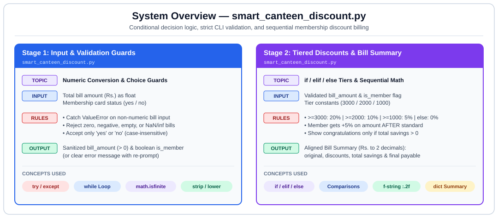
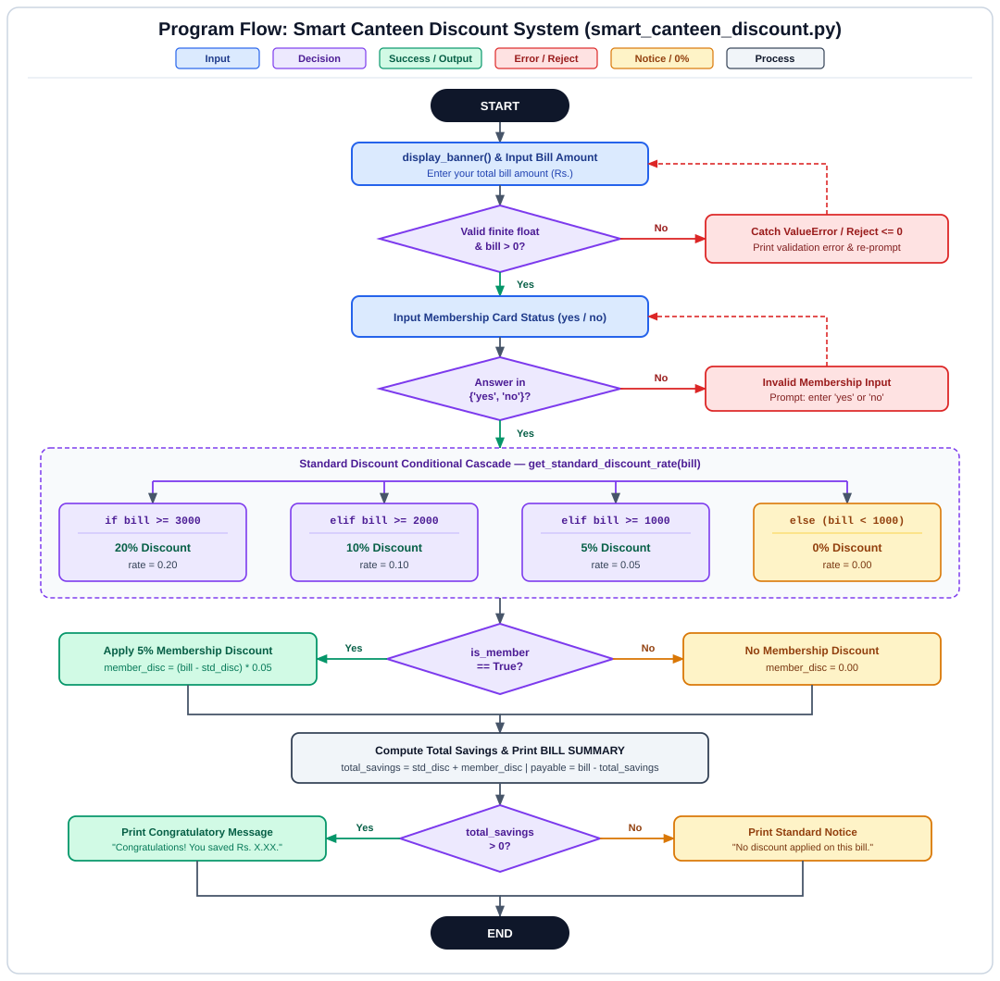
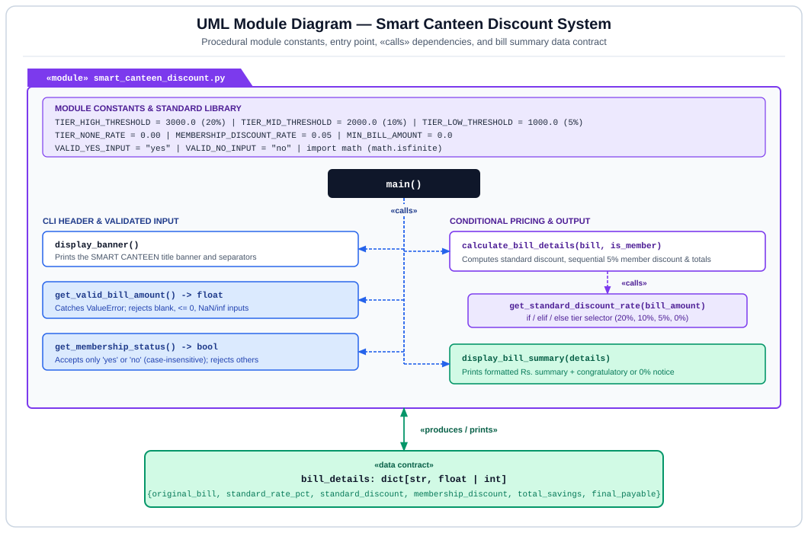

<p align="center"></p>

## 1. Project Overview

**Smart Canteen Discount System** is a beginner-friendly Python 3 console application demonstrating decision-making with `if`, `elif`, and `else`, comparison operators, input validation, and sequential percentage discounts in a college-canteen billing scenario.

| Stage | Component | File | Core Topics |
| --- | --- | --- | --- |
| Stage 1 | Input & Validation Guards | `smart_canteen_discount.py` | `input()`, `float()`, `try/except ValueError`, positive-bill check (`> 0`), strict `yes`/`no` membership validation |
| Stage 2 | Tiered Discounts & Bill Summary | `smart_canteen_discount.py` | `if / elif / else` cascade, `>=` comparisons, sequential 5% membership discount, `:.2f` f-string formatting |

### Standard Discount Tiers

| Bill Amount | Standard Discount |
| --- | ---: |
| Rs. 3,000 or more | 20% |
| Rs. 2,000 to below Rs. 3,000 | 10% |
| Rs. 1,000 to below Rs. 2,000 | 5% |
| Below Rs. 1,000 | 0% |

<p align="center"></p>

---

## 2. Folder Structure

```text
python-conditionals-smart-canteen/
├── assets/
│   ├── banner.svg
│   ├── overview.svg
│   ├── smart_canteen_discount_flow.svg
│   └── uml_diagram.svg
├── README.md
└── smart_canteen_discount.py
```

---

## 3. Core Program: Smart Canteen Discount System (`smart_canteen_discount.py`)

### Summary
`smart_canteen_discount.py` prompts the student for a total canteen bill amount in Pakistani Rupees (`Rs.`) and whether they hold a membership card (`yes`/`no`). It validates both inputs, selects one standard discount tier using an `if / elif / else` cascade, applies an optional 5% membership discount to the remaining amount after the standard discount, and displays an aligned bill summary with total savings and a status message.

### Rules & Requirements
- Reject bill amounts that are blank, non-numeric (`ValueError`), zero, negative (`<= 0`), or non-finite (`nan`/`inf`).
- Ask whether the student has a membership card and accept only `yes` or `no` (case-insensitive), rejecting any other input.
- Select the standard discount rate using mutually exclusive `if / elif / else` tiers: `>= 3000` → `20%`, `>= 2000` → `10%`, `>= 1000` → `5%`, below `1000` → `0%`.
- Apply an additional `5%` membership discount to the amount **remaining after** the standard discount.
  - *Example:* On a `Rs. 3,000` bill, the `20%` standard discount is `Rs. 600`. A member then receives `5%` of the remaining `Rs. 2,400` (`Rs. 120`), yielding `Rs. 720` total savings and a final bill of `Rs. 2,280`.
- Display original bill, standard discount (with tier percentage), membership discount, total savings, and final payable amount formatted to two decimal places (`:.2f`), followed by a congratulatory message when total savings exceed `Rs. 0.00`.

### Program Flow
<p align="center"></p>

### Code Methods Description

| Function / Section | Purpose |
| --- | --- |
| Constants (`TIER_HIGH_THRESHOLD`, `TIER_HIGH_RATE`, `TIER_MID_THRESHOLD`, `TIER_MID_RATE`, `TIER_LOW_THRESHOLD`, `TIER_LOW_RATE`, `TIER_NONE_RATE`, `MEMBERSHIP_DISCOUNT_RATE`, `MIN_BILL_AMOUNT`) | Centralizes all discount thresholds, rates, and validation bounds instead of using magic numbers. |
| `display_banner()` | Prints the `SMART CANTEEN` console title and separator lines. |
| `get_valid_bill_amount()` | Prompts until a valid finite numeric bill amount strictly greater than `0` is entered; catches `ValueError` for non-numeric text. |
| `get_membership_status()` | Prompts until `'yes'` or `'no'` (case-insensitive) is entered, returning `True` or `False`. |
| `get_standard_discount_rate(bill_amount)` | Evaluates the `if / elif / else` tier cascade (`>= 3000`, `>= 2000`, `>= 1000`, `else`) and returns the matching rate. |
| `calculate_bill_details(bill_amount, is_member)` | Computes standard discount, remaining balance, sequential 5% membership discount, total savings, and final payable amount in a structured dictionary. |
| `display_bill_summary(details)` | Prints the aligned `BILL SUMMARY` in `Rs.` to two decimal places plus a congratulatory message or a no-discount notice. |
| `main()` | Orchestrates header display, input collection (with `EOFError`/`KeyboardInterrupt` handling), calculation, and bill output. |

### Input Validation
- **Bill Amount:** Rejects empty input, text strings (e.g., `"three thousand"`), zero (`0`), negative numbers (e.g., `-450`), and non-finite floats (`nan`, `inf`), re-prompting with clear feedback.
- **Membership Answer:** Normalizes whitespace and casing (`.strip().lower()`) and rejects any response other than `yes` or `no` (such as `""`, `"maybe"`, or `"y"`).
- **Safe Interruption:** Catches `EOFError` and `KeyboardInterrupt` cleanly without printing a traceback.

### Expected Results
- Prints a clean, aligned `BILL SUMMARY` displaying `Original Bill`, `Standard Discount (X%)`, `Membership Discount`, `Total Savings`, and `Final Payable Amount` in `Rs.` formatted to 2 decimal places.
- Prints `Congratulations! You saved Rs. X.XX.` whenever either standard or membership discount produces positive savings; prints `No discount applied on this bill.` when savings are `Rs. 0.00`.

---

## 4. UML Diagram

A **UML Module Diagram** was chosen because `smart_canteen_discount.py` follows a procedural architecture organized around module constants, small single-responsibility functions, `«calls»` dependencies, and a dictionary data contract rather than OOP classes.

<p align="center"></p>

---

## 5. Concepts and Techniques Used

- **Conditional Statements (`if`, `elif`, `else`):** Selects exactly one standard discount tier from mutually exclusive bill ranges without redundant checks.
- **Comparison Operators:** Uses `>=`, `<=`, `>`, and `==` for threshold evaluation and validation bounds.
- **Input & Numeric Conversion:** Collects console input with `input()` and converts text to decimal currency values via `float()`.
- **Exception Handling (`try / except`):** Catches `ValueError` for invalid numeric entries and `EOFError`/`KeyboardInterrupt` for graceful cancellation.
- **Sequential Percentage Calculations:** Computes membership discount on the post-standard balance rather than stacking percentages blindly.
- **String Formatting:** Uses f-strings with column alignment (`:<31`) and two-decimal formatting (`:.2f`) alongside `Rs.` currency labels.
- **Console UI/UX Design:** Clear section separators (`=`), direct prompts, itemized discount lines, and friendly status/validation messages.

### Practice Challenges (Extensions)
1. *(Implemented)* Reject membership answers other than `yes` or `no`.
2. Add a user category (e.g., regular student vs. staff) with an extra discount rule.
3. Add a maximum discount cap (e.g., cap total savings at Rs. 1,000).
4. Print the named tier selected (e.g., Gold / Silver / Bronze / Standard).
5. Explain why `elif` is suitable here instead of independent `if` statements (with independent `if` statements, a Rs. 3,000 bill would match `>= 3000`, `>= 2000`, and `>= 1000` sequentially and overwrite the rate with 5%).

---

## 6. How to Run

### Requirements
- Python 3.6 or higher (standard library only — no third-party packages required).

### Clone the Repository
```bash
git clone https://github.com/Muhammad-Ajmal-Khan/python-conditionals-smart-canteen.git
cd python-conditionals-smart-canteen
```

### Run the Program
```bash
python smart_canteen_discount.py
```

Alternative commands (depending on OS/environment):
```bash
python3 smart_canteen_discount.py   # macOS / Linux
py smart_canteen_discount.py        # Windows Python Launcher
```

---

## 7. Sample Execution

All outputs below were captured directly from running `smart_canteen_discount.py` in Python 3.

### Run 1 — High Tier + Membership Card (Rs. 3,000, `yes`)
```text
================================
       SMART CANTEEN
================================
Enter your total bill amount (Rs.): 3000
Do you have a membership card? (yes/no): yes

================================
         BILL SUMMARY
================================
Original Bill:                 Rs. 3000.00
Standard Discount (20%):       Rs. 600.00
Membership Discount:           Rs. 120.00
Total Savings:                 Rs. 720.00
Final Payable Amount:          Rs. 2280.00
Congratulations! You saved Rs. 720.00.
```

### Run 2 — Below Rs. 1,000 Without Membership (No Discount Edge Case)
```text
================================
       SMART CANTEEN
================================
Enter your total bill amount (Rs.): 999.99
Do you have a membership card? (yes/no): no

================================
         BILL SUMMARY
================================
Original Bill:                 Rs. 999.99
Standard Discount (0%):        Rs. 0.00
Membership Discount:           Rs. 0.00
Total Savings:                 Rs. 0.00
Final Payable Amount:          Rs. 999.99
No discount applied on this bill.
```

### Run 3 — Below Rs. 1,000 With Membership Card (0% Standard + 5% Membership)
```text
================================
       SMART CANTEEN
================================
Enter your total bill amount (Rs.): 500
Do you have a membership card? (yes/no): yes

================================
         BILL SUMMARY
================================
Original Bill:                 Rs. 500.00
Standard Discount (0%):        Rs. 0.00
Membership Discount:           Rs. 25.00
Total Savings:                 Rs. 25.00
Final Payable Amount:          Rs. 475.00
Congratulations! You saved Rs. 25.00.
```

### Run 4 — Multiple Validation Failures Followed by Valid Input
```text
================================
       SMART CANTEEN
================================
Enter your total bill amount (Rs.): 
Invalid input! Bill amount cannot be empty. Please enter a positive number.
Enter your total bill amount (Rs.): three thousand
Invalid input! Please enter a valid numeric bill amount (e.g., 3000).
Enter your total bill amount (Rs.): 0
Invalid input! Bill amount must be greater than Rs. 0.
Enter your total bill amount (Rs.): -450
Invalid input! Bill amount must be greater than Rs. 0.
Enter your total bill amount (Rs.): nan
Invalid input! Bill amount must be greater than Rs. 0.
Enter your total bill amount (Rs.): 2500
Do you have a membership card? (yes/no): 
Invalid input! Please enter 'yes' or 'no'.
Do you have a membership card? (yes/no): maybe
Invalid input! Please enter 'yes' or 'no'.
Do you have a membership card? (yes/no): y
Invalid input! Please enter 'yes' or 'no'.
Do you have a membership card? (yes/no): no

================================
         BILL SUMMARY
================================
Original Bill:                 Rs. 2500.00
Standard Discount (10%):       Rs. 250.00
Membership Discount:           Rs. 0.00
Total Savings:                 Rs. 250.00
Final Payable Amount:          Rs. 2250.00
Congratulations! You saved Rs. 250.00.
```

---

## 8. Test Cases

### `smart_canteen_discount.py`

| # | Scenario | Inputs | Expected Result |
| --- | --- | --- | --- |
| 1 | High tier (`>= 3000`) with membership (Brief example) | Bill: `3000`, Member: `yes` | Standard `20%` (`Rs. 600.00`), Member `5%` of `2400` (`Rs. 120.00`), Total Savings `Rs. 720.00`, Final `Rs. 2280.00` + Congratulations |
| 2 | High tier without membership | Bill: `3500`, Member: `no` | Standard `20%` (`Rs. 700.00`), Member `Rs. 0.00`, Total Savings `Rs. 700.00`, Final `Rs. 2800.00` |
| 3 | Boundary just below Rs. 3,000 | Bill: `2999.99`, Member: `no` | Enters `10%` tier (`Rs. 300.00`), Final `Rs. 2699.99` |
| 4 | Exact mid tier boundary with uppercase `YES` | Bill: `2000`, Member: `YES` | Standard `10%` (`Rs. 200.00`), Member `5%` of `1800` (`Rs. 90.00`), Total Savings `Rs. 290.00`, Final `Rs. 1710.00` |
| 5 | Boundary just below Rs. 2,000 | Bill: `1999.99`, Member: `no` | Enters `5%` tier (`Rs. 100.00`), Final `Rs. 1899.99` |
| 6 | Exact low tier boundary with membership | Bill: `1000`, Member: `yes` | Standard `5%` (`Rs. 50.00`), Member `5%` of `950` (`Rs. 47.50`), Total Savings `Rs. 97.50`, Final `Rs. 902.50` |
| 7 | Boundary just below Rs. 1,000 (non-member) | Bill: `999.99`, Member: `no` | Standard `0%`, Member `Rs. 0.00`, Final `Rs. 999.99`, prints `"No discount applied on this bill."` |
| 8 | Below Rs. 1,000 with membership | Bill: `500`, Member: `yes` | Standard `0%`, Member `5%` (`Rs. 25.00`), Total Savings `Rs. 25.00`, Final `Rs. 475.00` + Congratulations |
| 9 | Smallest positive boundary | Bill: `0.01`, Member: `no` | Accepted as valid; Final `Rs. 0.01`, `"No discount applied on this bill."` |
| 10 | Multiple bill & membership validation failures | Bill: `""`, `"three thousand"`, `0`, `-450`, `nan` → `2500`; Member: `""`, `"maybe"`, `"y"` → `no` | Rejects each invalid entry with a clear error message, then computes `10%` discount (`Rs. 250.00`) and Final `Rs. 2250.00` |

---

**Author:** MUHAMMAD AJMAL KHAN — [GitHub Profile](https://github.com/Muhammad-Ajmal-Khan)
